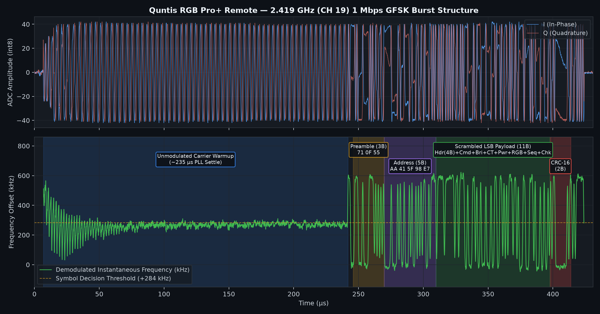

# Quntis RGB Pro+ 2.4 GHz RF Protocol Specification

This document details the reverse-engineered 2.4 GHz wireless protocol used by the **Quntis RGB Pro+ Monitor Light Bar** (Touch Remote with 14-LED ring and 15-mode RGB gaming backlight).



---

## 1. Hardware Architecture (Remote PCB)

Inspection of the physical remote PCB reveals three main ICs:
1. **Touch Controller / MCU (`IC3`):** **TMI TM6108** 6-channel capacitive touch controller (`CT1`–`CT6`), which stores the current lightbar state and drives the RF transceiver over 3-wire SPI.
2. **LED Ring Driver:** **VINKA VK1615** LED matrix controller driving the 14 status LEDs (`LED14`–`LED28`) along the bottom touch slider ring and 4 mode indicator LEDs (`LED29`–`LED32`).
3. **2.4 GHz RF Transceiver (`IC4`):** **Panchip XN297L** (16-pin SOP package, clocked by a `16.000 MHz` crystal `X2` on pins 10–11, RF output on pin 1 coupled via `EC2` to a PCB F-antenna). The PCB silkscreen right next to `IC4` is marked `2419` (`2419 MHz`).

---

## 2. Physical & Link Layer (XN297L)

| Parameter | Value |
| :--- | :--- |
| **Center Frequency** | `2419 MHz` (nRF24 / XN297 Channel `19`) |
| **Modulation** | `1 Mbps` GFSK ($\pm 290\text{ kHz}$ deviation) |
| **Carrier Warmup** | `~235 µs` unmodulated carrier before each packet (`~235` bit periods) |
| **Guard Bits** | `4 bits` (`1100`) immediately preceding the preamble |
| **Preamble** | `3 bytes` fixed XN297 sequence: **`0x71, 0x0F, 0x55`** (`01110001 00001111 01010101`) |
| **Address Length** | `5 bytes` (transmitted MSB-first per byte, reversed byte order on wire) |
| **Payload Length** | `11 bytes` (transmitted **LSB-first** per byte before scrambling, no ShockBurst PCF) |
| **Whitening / Scrambling** | XORed with the first 16 bytes of `xn297_scramble` across the 5B address + 11B payload |
| **CRC** | `16-bit` XN297 scrambled CRC-16 (`poly = 0x1021`, `init = 0xB5D2`, `xorout = 0xF494`) |

### XN297 Whitening Table (First 16 Bytes)
Every byte of the 5-byte wire address and 11-byte bit-reversed payload is XORed on the air with:
```c
static const uint8_t XN297_SCRAMBLE[16] = {
    0xE3, 0xB1, 0x4B, 0xEA, 0x85, // XORed with 5-byte wire address
    0xBC, 0xE5, 0x66, 0x0D, 0xAE, // XORed with payload bytes p[0..4]
    0x8C, 0x88, 0x12, 0x69, 0xEE, 0x1F // XORed with payload bytes p[5..10]
};
```

### CRC-16 Calculation
The 2-byte CRC at the end of the frame is computed over the **16 scrambled body bytes** (`body[0..15]`):
1. Initialize `crc = 0xB5D2`.
2. Update `crc` across all 16 scrambled bytes using polynomial `0x1021` (MSB-first).
3. XOR the final 16-bit value with `xn297_crc_xorout_scrambled[16 - 3] = 0xF494`.

---

## 3. Burst Timing

When a button is touched on the physical remote, the remote transmits **21 triplets (63 identical packets total)** over **`711 ms`**:
* **Single packet air time:** `425 µs` (`235 µs` unmodulated carrier + `190 µs` modulated frame)
* **Intra-triplet spacing (3 bursts per triplet):**
  * Burst 1 $\rightarrow$ Burst 2: **`3.93 ms`** start-to-start (`3.50 ms` gap)
  * Burst 2 $\rightarrow$ Burst 3: **`3.60 ms`** start-to-start (`3.18 ms` gap)
* **Inter-triplet spacing:**
  * Burst 3 of Triplet $k$ $\rightarrow$ Burst 1 of Triplet $k+1$: **`28.01 ms`** start-to-start (`27.58 ms` gap)
  * Total period per triplet: `35.54 ms` ($\times 20 = 710.8\text{ ms}$)

---

## 4. Payload Byte Structure (`p[0]`..`p[10]`)

After XORing `body[5..15]` with `XN297_SCRAMBLE[5..15]` and bit-reversing each byte (`bit_reverse`), the 11-byte payload `p[0..10]` has the following layout:

| Byte | Field Name | Description / Values |
| :---: | :--- | :--- |
| `p[0..3]` | **Header / Device ID** | `83 18 5B 01` (`p[0..2]` = 3-byte ID, `p[3] = 0x01` protocol version) |
| `p[4]` | **Command ID** | `0x31` = Front Light Power Toggle (On/Off)<br>`0x32` = RGB Backlight On / Cycle Mode<br>`0x35` = Brightness Up<br>`0x36` = Brightness Down<br>`0x39` = Color Temperature Change<br>`0x3D` = RGB Backlight Off (Long-press) |
| `p[5]` | **Target Brightness** | `0x00` = Off (when `p[4] = 0x31, p[7] = 0x00`)<br>`0x1A` (`26`) = Minimum brightness (~10%)<br>`0x55` (`85`) = 33% step<br>`0xA9` (`169`) = 66% step<br>`0xFF` (`255`) = Maximum brightness (100%)<br>*(The lightbar accepts any linear value from `0x1A` to `0xFF`.)* |
| `p[6]` | **Target Color Temp** | `0x47` (`71`) = Warm White (~3000K)<br>`0xA2` (`162`) = Neutral White<br>`0xFF` (`255`) = Cool White (~6500K)<br>*(Accepts continuous values from `0x1A` to `0xFF`.)* |
| `p[7]` | **Action Enable Flag** | `0xFF` = Turn/Keep Target Light ON<br>`0x00` = Turn Target Light OFF (Front Off when `p[4]=0x31`; RGB Off when `p[4]=0x3D`) |
| `p[8]` | **RGB Backlight State** | Bit 7 (`0x80`) = Always set (`1`)<br>Bits 0–3 (`1`–`15`) = Active RGB Mode (`0x81` = Mode 1 .. `0x8F` = Mode 15) |
| `p[9]` | **Sequence Counter** | `0x00`–`0xFF`, increments by `+1` on each button press; constant across all 63 bursts of a press |
| `p[10]` | **Application Checksum** | 8-bit arithmetic sum: `(p[0] + p[1] + ... + p[9]) & 0xFF` |

### Decoded Reference Captures (from `captures/`)

| Capture File | `p[0..3]` | `p[4]` (Cmd) | `p[5]` (Bri) | `p[6]` (CT) | `p[7]` (En) | `p[8]` (RGB) | `p[9]` (Seq) | `p[10]` (Chk) | On-Air CRC |
| :--- | :---: | :---: | :---: | :---: | :---: | :---: | :---: | :---: | :---: |
| `01_front_power_on.complex16s` | `83 18 5B 01` | `0x31` | `0x55` (33%) | `0x47` | `0xFF` | `0x8E` (14) | `0x60` | `0xB1` | `0xB005` |
| `02_front_power_off.complex16s` | `83 18 5B 01` | `0x31` | `0x00` (0%) | `0xA2` | `0x00` | `0x8E` (14) | `0x84` | `0xDC` | `0x8950` |
| `03_brightness_min_10pct.complex16s` | `83 18 5B 01` | `0x36` | `0x1A` (10%) | `0xA2` | `0xFF` | `0x8E` (14) | `0xBB` | `0x31` | `0x2656` |
| `04_brightness_up_33pct.complex16s` | `83 18 5B 01` | `0x35` | `0x55` (33%) | `0xA2` | `0xFF` | `0x8E` (14) | `0x8E` | `0x3E` | `0xFDB3` |
| `05_brightness_down_66pct.complex16s` | `83 18 5B 01` | `0x36` | `0xA9` (66%) | `0xA2` | `0xFF` | `0x8E` (14) | `0x99` | `0x9E` | `0xA897` |
| `06_brightness_max_100pct.complex16s` | `83 18 5B 01` | `0x35` | `0xFF` (100%) | `0xA2` | `0xFF` | `0x8E` (14) | `0xDC` | `0x36` | `0x3E10` |
| `07_colortemp_warm_28pct.complex16s` | `83 18 5B 01` | `0x39` | `0x55` (33%) | `0x47` | `0xFF` | `0x8E` (14) | `0xEE` | `0x47` | `0x215F` |
| `08_colortemp_cool_100pct.complex16s` | `83 18 5B 01` | `0x39` | `0x55` (33%) | `0xFF` | `0xFF` | `0x8E` (14) | `0xF2` | `0x03` | `0x8C63` |
| `09_rgb_backlight_on_mode14.complex16s` | `83 18 5B 01` | `0x32` | `0x55` (33%) | `0xFF` | `0xFF` | `0x8E` (14) | `0xF3` | `0xFD` | `0x59ED` |
| `10_rgb_backlight_off.complex16s` | `83 18 5B 01` | `0x3D` | `0x55` (33%) | `0xFF` | `0x00` | `0x81` (1) | `0xF7` | `0x00` | `0x8E56` |

---

## 5. Interfacing an nRF24L01+ with the XN297L

Although the Nordic **nRF24L01+** does not natively support the XN297L's 3-byte preamble (`0x71 0x0F 0x55`) or hardware whitening, it can both **transmit** and **receive** XN297L frames in software:

1. **Transmitting (`TX Mode`):**
   * Configure `SETUP_AW = 0x01` (3-byte address width) and set `TX_ADDR = {0x55, 0x0F, 0x71}` (which the nRF24L01+ shifts out MSByte-first on the air as `0x71, 0x0F, 0x55`).
   * Write the 16 scrambled body bytes + 2 CRC bytes (`18 bytes` total) as a static payload (`W_TX_PAYLOAD`) with hardware CRC and Auto-ACK disabled.
2. **Receiving / Sniffing (`RX Mode`):**
   * An nRF24L01+ requires a 1-byte `0x55` (`01010101`) preamble before an RX pipe address whose first bit on the air is `0`.
   * Because the 3rd byte of the XN297L preamble (`0x71 0x0F 0x55`) is literally **`0x55`**, setting `SETUP_AW = 0x03` (5-byte address width) and `RX_ADDR_P0` to the 5-byte scrambled address (`04 29 14 AB 2F`) causes the nRF24L01+ hardware correlator to treat the trailing `0x55` of the XN297 preamble as its own 1-byte preamble, match the 5-byte scrambled address in hardware, and place the remaining **13 bytes** (11 scrambled payload bytes + 2 CRC bytes) into the RX FIFO.
   * For **promiscuous address discovery (Pairing / Sniffer Mode)**, setting `SETUP_AW = 0x01` (3-byte address width), `RX_ADDR_P0 = {0x55, 0x0F, 0x71}`, and `RX_PW_P0 = 18` captures the entire 16-byte scrambled body + 2-byte CRC of *any* Quntis XN297L remote held near the antenna.

